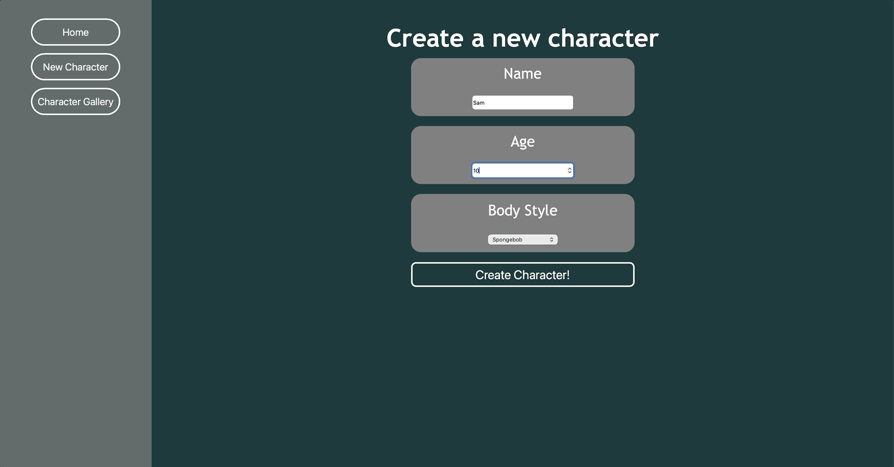

# Web103 Project 7 - Bikini Bottom Creator

A character creation and management application built with React, Vite, and Supabase. Users can create custom characters inspired by SpongeBob SquarePants, view their characters in a gallery, and edit or delete existing characters.

This project was developed as part of CodePath's WEB102 Web Development course.

## Demo



## Features

### Character Creation
- Create characters with a custom name and age.
- Select from multiple SpongeBob-inspired body styles.
- Validate required form fields before submission.
- Save character information to a Supabase database.

### Character Gallery
- View created characters in a responsive grid layout.
- Display each character's name, age, and body style.
- Dynamically generate character cards using React components.
- Retrieve character data directly from Supabase.

### Character Editing
- Navigate to a dedicated editing page for each character.
- Automatically populate form fields with existing character information.
- Update character details in Supabase.
- Identify individual characters using dynamic React Router parameters.

### Character Deletion
- Delete individual characters from the database.
- Display a confirmation prompt before deletion.
- Return to the character gallery after successful deletion.

## Technologies Used

| Technology | Purpose |
|------------|---------|
| React | Frontend UI development |
| JavaScript | Application logic |
| Vite | Development server and build tool |
| React Router | Page navigation and dynamic routing |
| Supabase | Database and backend services |
| CSS3 | Styling and responsive layouts |

## Getting Started

### Prerequisites

Before running this project, make sure you have:

- Node.js and npm installed
- A Supabase project
- Your Supabase Project URL and publishable API key

### Installation

**1. Clone the repository**

```bash
git clone https://github.com/SamM-SWE/WEB102-PROJECT7.git
```

**2. Navigate into the project directory**

```bash
cd WEB102-PROJECT7
```

**3. Install dependencies**

```bash
npm install
```

**4. Configure environment variables**

Create a `.env` file in the root directory:

```env
VITE_SUPABASE_URL=your_supabase_project_url
VITE_SUPABASE_PUBLISHABLE_KEY=your_supabase_publishable_key
```

Replace the placeholder values with your Supabase project credentials.

**Important:** Never expose Supabase secret or service-role keys in frontend environment variables. Configure appropriate Row Level Security policies for database access.

**5. Start the development server**

```bash
npm run dev
```

Open the local URL displayed in your terminal, typically:

```text
http://localhost:5173
```

## How It Works

### Creating a Character

1. Navigate to the character creation page.
2. Enter a character name and age.
3. Select a body style.
4. Click **Create Character**.
5. The application validates the form and submits the character data to Supabase.

### Viewing Characters

The character gallery retrieves stored character data from Supabase using:

```javascript
const { data, error } = await supabase
  .from("characters")
  .select("*");
```

React's `.map()` method dynamically generates a character card for each returned record.

### Editing Characters

Each character has a unique identifier used for navigation.

Example route:

```text
/character/edit/:id
```

React Router's `useParams()` retrieves the character ID, allowing the application to fetch and update the selected character.

### Deleting Characters

Characters can be deleted using Supabase's `.delete()` method with an ID filter.

```javascript
const { error } = await supabase
  .from("characters")
  .delete()
  .eq("id", id);
```

A confirmation prompt helps prevent accidental deletion.

## Database Structure

The application uses a Supabase table named `characters`.

| Column | Description |
|--------|-------------|
| id | Unique character identifier |
| name | Character name |
| age | Character age |
| character_type | Selected SpongeBob body style |

Supabase Row Level Security policies control database access.

## Available Scripts

```bash
npm run dev
```
Starts the development server.

```bash
npm run build
```
Builds the application for production.

```bash
npm run preview
```
Previews the production build locally.

```bash
npm run lint
```
Runs the project's linter.

## Future Improvements

- Add character search and filtering.
- Implement character sorting.
- Add user authentication.
- Allow users to manage their own character collections.
- Improve mobile responsiveness.
- Add additional character customization options.

